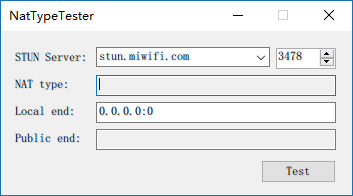

# STUN Server
Docker
```
docker pull hmbsbige/stunserver
docker run -d --restart=always --net=host --name=stunserver hmbsbige/stunserver --mode full --primaryinterface $IP1 --altinterface $IP2
```

# STUN Client Preview


---

## 本仓库的改动（基于上游 tag `1.3`）

### 1. 异常提示人性化

上游 `MainForm.Core()` 里是 `MessageBox.Show($"Error: {ex}")`，
于是域名写错、服务器下线、UDP 被封这类**最常见的用户操作问题**，
都会弹出完整的 `SocketException` 堆栈（`0x80004005 不知道这样的主机`），
对普通用户毫无意义。

现在按 `SocketErrorCode` 分类给中文提示：

| SocketErrorCode | 提示 |
| --- | --- |
| `HostNotFound` / `NoData` (11001/11004) | 域名在公共 DNS 查不到（NXDOMAIN），服务已下线或域名被回收，并推荐可用服务器 |
| `TryAgain` (11002) | 本机 DNS 临时故障，请稍后重试 |
| `TimedOut` (10060) | 服务器无响应，说明端口被封或 UDP 被拦 |
| `NetworkUnreachable` / `HostUnreachable` | 网络不可达，检查网络 / VPN / 代理 |
| `ConnectionRefused` | 端口没在监听 |
| 其他 | 简述 + 错误码 |

完整堆栈仍保留，写入 `%TEMP%\NatTypeTester_error.log`，
弹窗里给出日志路径 —— 需要排查时也不丢信息。

另外：本地地址格式错误单独给出正确写法示例；每次点 Test 先清空上次结果，
避免失败时残留的旧 NAT 类型造成误读。

### 2. 默认服务器列表更新为实测可用的

上游列表里 4 个域名已失效（实测 NXDOMAIN / 无响应）：

| 服务器 | 状态 |
| --- | --- |
| `stun.bige0.com` | NXDOMAIN，作者域名下的子域记录已删除 |
| `stun.stunprotocol.org` | NXDOMAIN |
| `iphone-stun.strato-iphone.de` | NXDOMAIN |
| `numb.viagenie.ca` | NXDOMAIN |
| `stun.xten.com` | 解析到 216.93.246.18，无响应 |
| `stun.ekiga.net` | 同上，无响应 |

现列表（3478/UDP，实测 BindingSuccess）：

| 服务器 | 实测 RTT |
| --- | --- |
| `stun.miwifi.com` | ~22 ms |
| `stun.hitv.com` | ~44 ms |
| `stun.cloudflare.com` | ~145 ms |
| `stun.schlund.de` | ~409 ms |
| `stun.voipstunt.com` | ~360 ms |

Google 的 `stun.l.google.com` 用的是 **19302** 端口，不是 3478，
所以没放进列表（端口框默认 3478，放进去只会徒增困惑）。
需要时手动填 `stun.l.google.com` + 端口 `19302`。

### 3. 图标

上游 exe 用的是 .NET 默认的空白图标，桌面上分不出是什么程序。

新图标：一堵虚线（NAT 边界）被一条双向箭头凿穿 —— UDP 打洞；
左端绿色是内网侧、右端橙色是公网侧。


生成器在 `tools/make_icon.py`（Pillow，1024 超采样后 LANCZOS 降采样），
产出 `NatTypeTester/app.ico`，含 16/24/32/48/64/128/256 七种尺寸，
由 csproj 的 `<ApplicationIcon>` 嵌进 exe 的 RT_GROUP_ICON 资源，
窗口标题栏与任务栏自动跟随。

各尺寸实际渲染：


### 4. GitHub Actions 编译

`.github/workflows/build.yml`：`windows-latest` + `setup-msbuild`，
`Release|Any CPU` 生成后把 `NatTypeTester.exe` 作为 artifact 上传。
Actions 跑完在对应 run 页面下载 `NatTypeTester-friendly` 即可。

上游的子模块 `NatTypeTester/Lumisoft.Net` 已把源码内置进仓库，
不再需要 `git submodule`，clone 下来直接可编译。

---

上游项目：[HMBSbige/NatTypeTester](https://github.com/HMBSbige/NatTypeTester)（MIT）
